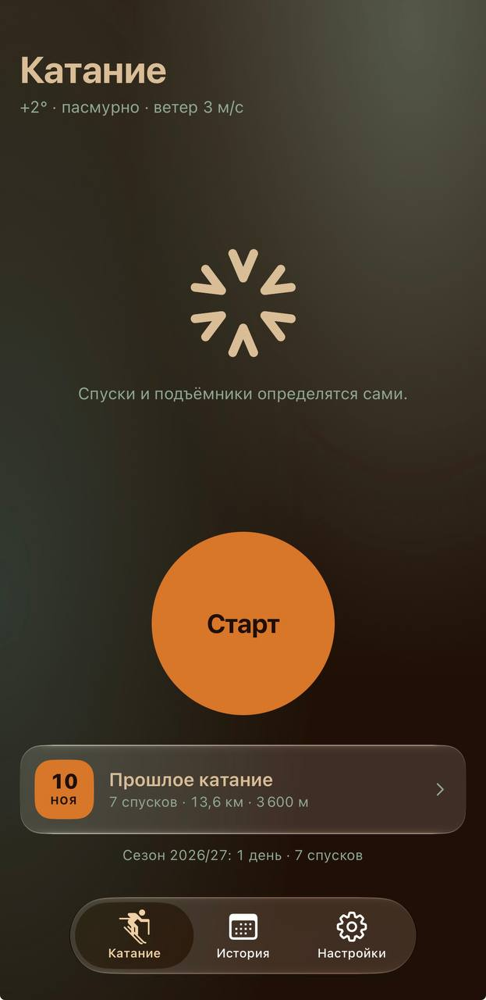
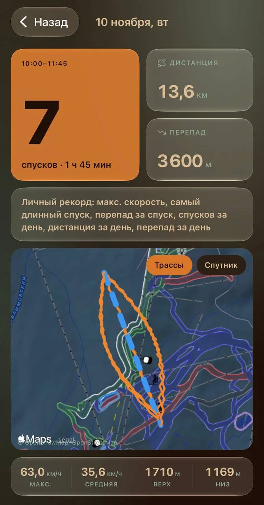
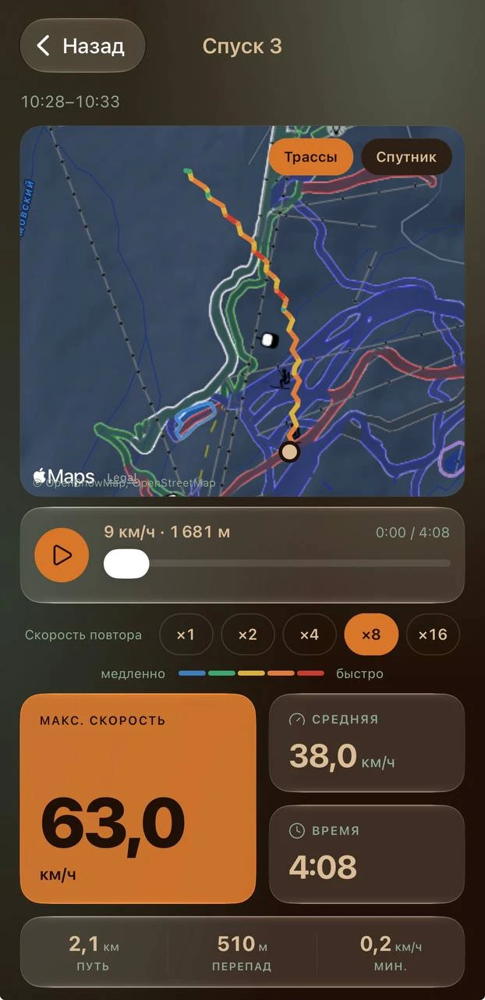
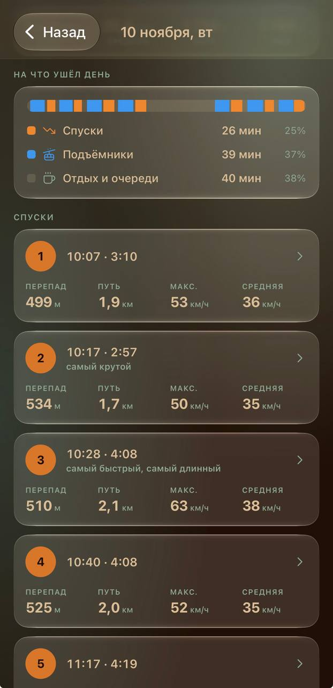
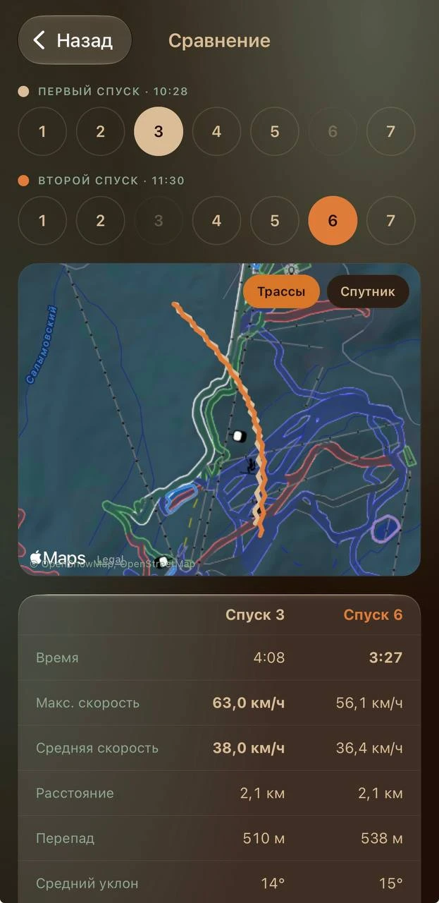
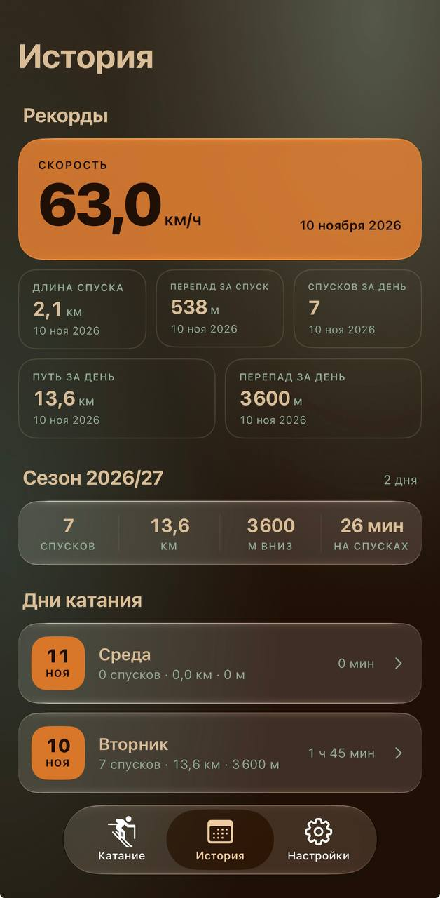
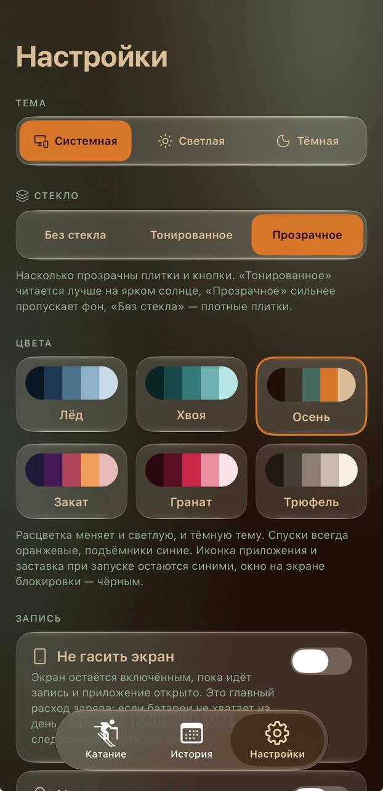

<div align="center">


# Snowwy

[](../../releases/latest)


[iPhone](#установка-на-iphone) · [Android](#установка-на-android) · [Вкладки](#вкладки-приложения) · [Профиль](#профиль) · [Друзья](#друзья-что-нужно-знать) · [Приватность](#приватность) · [Вопросы](#частые-вопросы) · [Сборка из исходников](#сборка-из-исходников)

</div>

---

**Snowwy — трекер катания на горных лыжах и сноуборде для iPhone и Android.** Нажимаете «Старт» перед первым подъёмом, убираете телефон в карман — приложение само находит спуски и подъёмники, считает скорость, расстояние и перепад и рисует всё на карте.

После катания остаётся разбор дня: каждый спуск с графиками и названием трассы, **повтор спуска на карте**, сравнение двух спусков между собой, личные рекорды и итоги сезона. Запись идёт с заблокированным экраном, а главное видно в **окне на экране блокировки и в «островке»** на iPhone и в **уведомлении с кнопками** на Android.

Ещё в Snowwy есть профиль с 45 достижениями, голосовой ассистент в наушниках, группа друзей, которые видят друг друга на склоне и назначают встречи, резервная копия одним файлом и шесть расцветок со «стеклом».

> [!NOTE]
> Рекламы, доната и телеметрии нет. Аккаунт для приложения не нужен, записи хранятся только на телефоне. Исходный код открыт.

<p align="center">
  
  
  
</p>

## Установка на iPhone

Приложения нет в App Store. Файл `Snowwy-<версия>.ipa` — на странице [Releases](../../releases), в самом свежем релизе, где он есть: некоторые версии выходят только для Android. На телефон он ставится с компьютера с помощью бесплатного Apple ID. Mac не нужен.

1. Скачайте `.ipa` из последнего релиза.
2. Установите на компьютер программу для установки приложений, например [iLoader](https://github.com/nab138/iloader) или Sideloadly.
3. Подключите iPhone кабелем, разблокируйте и нажмите «Доверять этому компьютеру».
4. Откройте в программе скачанный `.ipa` и войдите со своим Apple ID: он нужен, чтобы Apple выдала подпись.
5. На iPhone: «Настройки» → «Основные» → «VPN и управление устройством» → ваш Apple ID → «Доверять».
6. Включите режим разработчика: «Настройки» → «Конфиденциальность и безопасность» → «Режим разработчика».

- **Геопозиция.** При первом старте записи выберите «При использовании», затем «Разрешить всегда» — тогда запись продолжится с заблокированным экраном.
- **Три приложения.** С бесплатным Apple ID на телефоне одновременно работает не больше трёх таких приложений.

> [!TIP]
> С бесплатным Apple ID приложение работает 7 дней, потом его нужно поставить заново тем же способом. Ставьте поверх, не удаляя: записи сохранятся.

## Установка на Android

Приложения нет в Google Play. Последняя версия — на странице [Releases](../../releases/latest): файл `Snowwy-<версия>.apk`. Компьютер не нужен, срок работы не ограничен. Подходит Android 7 и новее; сервисы Google не обязательны.

1. Откройте на телефоне страницу последнего релиза и скачайте `.apk`.
2. Откройте скачанный файл. Если телефон спросит, разрешите браузеру устанавливать приложения.
3. Нажмите «Установить».

Обновляться можно прямо из приложения: «Настройки» → «Обновления». Snowwy раз в сутки сам проверяет, вышла ли новая версия, скачивает её и открывает окно установки; записи сохраняются. Первый раз Android попросит разрешить Snowwy устанавливать приложения. Версии до 1.0.3 этого не умеют — 1.0.3 нужно один раз поставить вручную.

- **Геопозиция.** При первом старте записи разрешите доступ «Только во время использования приложения» и уведомления. Пока идёт запись, в шторке висит уведомление Snowwy — благодаря ему запись продолжается с заблокированным экраном.
- **Работа в фоне.** Android закрывает приложения в фоне ради батареи, а Xiaomi, Samsung, Huawei и другие делают это ещё жёстче. При первой записи Snowwy попросит снять ограничение. Защиту производителя нужно выключить вручную: пошаговая инструкция для вашего телефона — в «Настройки» → «Работа в фоне».

> [!IMPORTANT]
> Без снятых ограничений запись может оборваться, пока телефон лежит в кармане. Перед первым выездом проверьте настройки и запишите короткую прогулку с заблокированным экраном.

## Вкладки приложения

### Катание

<p align="center"></p>

Стартовая вкладка. До записи на ней погода, кнопка «Старт» и прошлое катание, во время записи — скорость, счёт спусков и карта.

- **Спуски находятся сами.** Приложение по высоте и скорости делит день на спуски, подъёмы и остановки. Спуском считается участок вниз с перепадом от 5 метров, а пологий — от метра, если ехать быстрее 15 км/ч: так считаются выкаты и переезды по ровному. Очередь на подъёмник и сборы наверху в спуск не попадают, остановка от 4 минут делит спуск на два.
- **Запись в фоне.** Продолжается с заблокированным экраном и в кармане.
- **Окно на экране блокировки и «островок».** Главные показатели и время катания. В раскрытом «островке» — кнопки «Пауза» и «Завершить».
- **Точные высота и скорость.** Высота уточняется по барометру телефона, скорость очищается от скачков GPS: пока вы стоите, она не «прыгает».
- **Пауза и напоминания.** Через полчаса на одном месте приходит уведомление, через два часа запись завершается сама и сохраняется. О записи, забытой на паузе, приложение напомнит через час.
- **Ассистент.** Голосом в наушниках сообщает итоги спуска, высоту после подъёма и итог дня. Музыка на это время становится тише. По умолчанию выключен.
- **Экономия заряда.** При заблокированном экране точки обрабатываются пачками. Все точки при этом пишутся, спуски считаются так же точно.
- **Итоги после завершения.** Число спусков, дистанция, перепад, самый быстрый спуск и побитые личные рекорды.

---

### День катания

<p align="center">
  
  
</p>

Открывается из «Истории» или сразу после завершения записи.

- **Итоги дня плитками:** спуски, дистанция, перепад, скорость и время.
- **Карта.** Спуски — оранжевой линией, подъёмники — синим пунктиром. Кнопка «Трассы» включает слой горнолыжных трасс и подъёмников, «Спутник» — снимок местности.
- **Погода в начале катания:** температура, ветер, снег.
- **На что ушёл день.** Сколько времени заняли спуски, подъёмники и отдых.
- **Список спусков.** У каждого — название и сложность трассы (по данным OpenStreetMap), время, скорость и перепад.
- **Поделиться.** Карточка с итогами дня для мессенджеров и экспорт трека в GPX.

---

### Спуск

<p align="center">
  
  
</p>

Открывается нажатием на спуск в списке.

- **Трек по скорости.** Линия на карте раскрашена от синего (медленно) к красному (быстро).
- **Показатели:** средняя, максимальная и минимальная скорость, путь, перепад, время и уклон.
- **Графики скорости и высоты.** Слева шкала с делениями. Если провести пальцем по графику, появится линия, а над ней — скорость или высота в эту секунду спуска.
- **Повтор спуска.** Точка едет по треку со скоростью от ×1 до ×16, ползунок перематывает в любое место.
- **Сравнение.** Два спуска рядом: общая карта, таблица с выделенным лучшим результатом и графики. Графики построены по пройденному пути, а не по времени, поэтому два спуска по одной трассе совпадают участок к участку.

---

### История

<p align="center"></p>

Все дни катания и то, что из них складывается.

- **Рекорды.** Максимальная скорость, длина спуска, перепад за спуск, а также спуски, путь и перепад за день. У каждого рекорда стоит дата.
- **Любимые трассы.** Трассы, по которым вы спускались чаще всего.
- **Итоги сезона:** дни, спуски, километры, метры вниз и время на спусках.
- **Дни катания.** Нажатие на день открывает его разбор.

---

### Друзья

Группа, участники которой видят друг друга на карте во время катания.

- **Карта и список.** На карте — метки участников с их аватарками поверх слоя трасс. В списке — имя, состояние («на спуске», «на подъёмнике», «на паузе», «нет связи»), где человек относительно вас («350 м ↗ · выше на 120 м»), заряд его телефона и сколько прошло с последнего обновления. Значок слева показывает человека на карте.
- **Карточка друга.** Нажатие на человека открывает его карточку: баннер и аватарка, итоги сегодняшнего дня (скорость, перепад, самый длинный спуск, время на спусках), личные рекорды и достижения. Итоги и заряд можно скрыть в настройках. Карточка закрывается свайпом вниз за верхнюю часть.
- **Точка встречи.** Любой участник отмечает место на карте, пишет, где именно, и выбирает время на колёсах часов и минут, как в будильнике. Все получают уведомление, а за 20 минут и в само время — напоминание. Место встречи видно на карте флажком.
- **Вход по приглашению.** QR-код, если вы рядом, или сообщение с приглашением, если нет.
- **Права создателя.** Создатель группы исключает участников, меняет приглашение и удаляет группу.
- **Только во время записи.** Место отправляется раз в 30 секунд, пока идёт запись. После завершения оно убирается с карты у остальных. Показ себя выключается одним переключателем.

Как это устроено и что для этого нужно — в разделе «[Друзья: что нужно знать](#друзья-что-нужно-знать)».

---

### Профиль

Ваше имя, аватарка и баннер, достижения и рекорды.

- **Аватарка и баннер.** Выбираются из галереи и сразу обрезаются: аватарка квадратом, баннер полосой. Если вы в группе, их видят друзья — в списке, на карте и в вашей карточке.
- **Достижения.** 45 значков в пяти разделах: максимальная скорость, средняя скорость за спуск, длина спуска, перепад за спуск и расстояние за день. Чем выше планка, тем ценнее значок — от бронзы до «Сияния». У следующего ещё не полученного значка видно, сколько до него осталось.
- **Рекорды** и короткие итоги: дни на склоне, спуски, километры и метры вниз.
- **Моя карточка для друзей.** Показывает, как вашу карточку видят остальные участники группы.

---

### Настройки

<p align="center"></p>

Изменения применяются сразу и хранятся только на телефоне.

- **Тема:** системная, светлая или тёмная.
- **Стекло.** Три степени прозрачности плиток и кнопок: без стекла, тонированное и прозрачное. На iOS 26 это настоящее Liquid Glass, на Android и старых iOS — полупрозрачные плитки.
- **Цвета.** Шесть расцветок: «Лёд», «Хвоя», «Осень», «Закат», «Гранат», «Трюфель». Спуски всегда оранжевые, подъёмники синие — так они различимы в любой расцветке.
- **Запись:** не гасить экран, напоминать о забытой записи.
- **Во время катания:** ассистент и экономия заряда.
- **Друзья:** показ себя группе и аккаунт Cloudflare создателя группы.
- **Резервная копия.** Файл со всеми записями обновляется после каждого катания. На iPhone он виден в приложении «Файлы», на Android лежит в папке, которую вы выберете, например в «Документах». Копию можно сохранить в другое место и восстановить из неё: добавятся только дни, которых ещё нет в истории.
- **Работа в фоне** (Android). Снимает ограничение батареи и показывает, где выключить защиту производителя.
- **Демо-катание.** Выдуманный день на семь спусков, чтобы посмотреть приложение без выезда на склон.

## Друзья: что нужно знать

Общего сервера у Snowwy нет. У каждой группы свой небольшой сервер — в бесплатном аккаунте Cloudflare её создателя. Так места участников не собираются в одном месте, а лимиты одной группы не зависят от остальных.

- **Создателю группы** нужен аккаунт Cloudflare: почта и пароль. Регистрация открывается прямо из приложения, дальше оно само размещает сервер. Это делается один раз.
- **Участникам** аккаунт не нужен: достаточно приглашения.
- **Snowwy должен стоять у каждого.** Друзей без приложения на карте не будет.
- **Лимит.** Бесплатного тарифа Cloudflare хватает примерно на 100 человек, катающихся в один день на сервере одного создателя. В группе может быть до 50 человек.
- **Нужен интернет на склоне.** Без связи место участника остаётся на последней известной точке с пометкой «нет связи».

Имена, места, итоги дня, аватарки и баннеры шифруются на телефоне ключом группы (AES-256-GCM). Ключ передаётся только в приглашении и на сервер не попадает, поэтому сервер хранит записи, но прочитать их не может.

## Приватность

- **Телеметрия.** Никакой телеметрии и аналитики.
- **Где хранятся данные.** Записи катания, настройки и резервная копия хранятся только на телефоне.
- **Погода, слой трасс, названия трасс.** Запрашиваются у [Open-Meteo](https://open-meteo.com), [OpenSnowMap](https://www.opensnowmap.org) и [OpenStreetMap](https://www.openstreetmap.org). Им передаётся только район катания — без трека и без результатов.
- **Без интернета.** Запись катания и разбор работают как обычно; не будет только погоды, слоя трасс и названий.
- **Друзья.** Единственное, что отправляет ваше место другим людям, и только если вы вошли в группу. Сервер группы видит зашифрованные записи, время запросов и IP-адреса. Его адрес известен только участникам.
- **Аккаунт Cloudflare.** Пароль вводится на странице Cloudflare, приложение его не видит. Ключ доступа хранится в защищённом хранилище телефона и отправляется только в Cloudflare.
- **Камера.** Нужна только чтобы отсканировать QR-код с приглашением в группу.
- **Галерея.** Нужна только чтобы выбрать аватарку и баннер. Картинки копируются в приложение, а друзьям уходят в уменьшенном и зашифрованном виде.
- **Карта на Android.** Схема — [OpenFreeMap](https://openfreemap.org), снимки со спутника — Esri. Ключи, аккаунт Google и сервисы Google не нужны.

## Частые вопросы

<details>
<summary><b>Почему приложения нет в App Store?</b></summary>

Для публикации нужен платный аккаунт разработчика Apple. Пока Snowwy распространяется файлом на этой странице и ставится с компьютера.

</details>

<details>
<summary><b>Приложение перестало открываться. Что делать?</b></summary>

Скорее всего, прошло 7 дней и истекла подпись бесплатного Apple ID. Поставьте тот же файл заново поверх, не удаляя приложение: записи останутся на месте.

</details>

<details>
<summary><b>Пропадут ли записи, если удалить приложение?</b></summary>

Да, вместе с резервной копией внутри него. Перед удалением сохраните копию в другое место: «Настройки» → «Сохранить копию в другое место». После установки её можно восстановить там же.

</details>

<details>
<summary><b>Как перенести записи на другой телефон?</b></summary>

Сохраните резервную копию в iCloud Drive или отправьте себе в мессенджер, на новом телефоне откройте «Настройки» → «Восстановить из копии» и выберите этот файл.

</details>

<details>
<summary><b>Нужен ли интернет на склоне?</b></summary>

Для записи — нет: спуски, скорость и перепад считаются по GPS и барометру. Интернет нужен для погоды, слоя трасс на карте, названий трасс и чтобы видеть друзей.

</details>

<details>
<summary><b>Что делать, если батареи не хватает на день?</b></summary>

Больше всего заряда тратит включённый экран. Выключите «Не гасить экран» и включите «Экономию заряда» в настройках: запись продолжится с заблокированным экраном, а главное будет видно в окне на экране блокировки.

</details>

<details>
<summary><b>Почему спуск не засчитался?</b></summary>

Спуском считается участок вниз длиной от 15 метров с перепадом от 5 метров, а пологий — с перепадом от метра, если ехать быстрее 15 км/ч. Совсем короткие съезды и переходы пешком в счёт не идут.

</details>

<details>
<summary><b>Откуда берутся названия трасс?</b></summary>

Из OpenStreetMap: приложение сопоставляет трек спуска с трассами на карте. Если курорт на карте размечен не полностью, у части спусков названия не будет.

</details>

<details>
<summary><b>Как кататься с друзьями?</b></summary>

Один человек создаёт группу во вкладке «Друзья» и показывает остальным QR-код или отправляет приглашение сообщением. Остальные входят через «Войти по приглашению». Дальше все, у кого идёт запись, видят друг друга на карте.

</details>

<details>
<summary><b>Есть ли версия для Android?</b></summary>

Есть, с теми же возможностями. Вместо окна на экране блокировки и «островка» — уведомление в шторке со спусками, расстоянием и кнопками «Пауза» и «Завершить». Как установить — в разделе «[Установка на Android](#установка-на-android)».

</details>

## Сборка из исходников

Приложение написано на Expo (React Native) и TypeScript. Нужен [Node.js 24+](https://nodejs.org).

```bash
npm install         # зависимости (один раз)
npx expo start      # запуск для Expo Go
npm test            # проверка алгоритмов: спуски, скорость, трассы, сервер группы
npm run typecheck   # проверка типов
npx expo lint       # линтер
```

В Expo Go не работают окно на экране блокировки, «островок», запись в фоне и ассистент — для них нужна сборка. Место друзьям в Expo Go отправляется только при открытом приложении.

**Сборка `.ipa`** идёт на GitHub Actions: вкладка Actions → «iOS (.ipa)» → Run workflow. Файл получается неподписанным и публикуется в Releases. Номер версии берётся из поля `version` в `app.json`.

**Сборка `.apk`** — там же, «Android (.apk)», около 15 минут. Файл кладётся в тот же релиз. Для проверки на компьютере подойдёт эмулятор из Android SDK: `npx expo run:android` собирает и ставит приложение, а `node scripts/android-replay.mjs` «проезжает» в эмуляторе выдуманный день катания.

<details>
<summary><b>Где что лежит</b></summary>

- `src/lib/analyze.ts` — поиск спусков и подъёмов в треке, вся статистика.
- `src/lib/achievements.ts` — достижения и их уровни; `src/lib/profile.ts` — аватарка и баннер.
- `src/lib/tracker.ts` — запись GPS и состояние текущего катания.
- `src/lib/speed.ts` — очистка скорости от скачков.
- `src/lib/pistes.ts` — названия трасс по карте.
- `src/lib/db.ts` — хранение (SQLite на устройстве).
- `src/lib/friends/` — группа друзей: шифрование, обмен с сервером группы, подключение аккаунта Cloudflare.
- `server/worker.mjs` — сервер группы (Cloudflare Worker с базой D1). Приложение размещает его в аккаунте создателя группы само; после правки запустите `node scripts/embed-worker.mjs`.
- `src/app/` — экраны, `src/components/` — общие элементы, `src/theme.ts` — расцветки.
- `src/widgets/` — окно на экране блокировки и «островок»; `src/lib/ride-notification.ts` — уведомление с ходом катания на Android.
- `modules/snowwy-voice` — ассистент: Swift для iPhone, Kotlin для Android.
- `modules/snowwy-power` — Android: проверка ограничения батареи и переход в настройки автозапуска производителя.
- `src/components/track-map.android.tsx` — карта для Android (MapLibre).
- `scripts/patch-expo-widgets.mjs` — правка, с которой окно на экране блокировки работает при установке с бесплатным Apple ID.

</details>

## Благодарности

Карты трасс — © участники [OpenStreetMap](https://www.openstreetmap.org/copyright) и [OpenSnowMap](https://www.opensnowmap.org). Погода — [Open-Meteo](https://open-meteo.com). Иконки интерфейса — [Lucide](https://lucide.dev).

Snowwy — независимый проект, он не связан с Apple и горнолыжными курортами.
